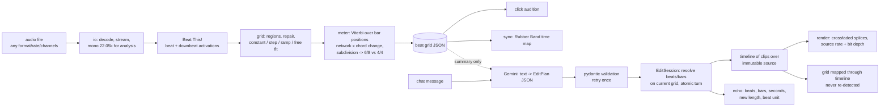

# Beat Agent

One chat-driven agent for audio: (1) a beat grid you can trust and two-track beat-matching, (2) chat
edits addressed in beats and bars, applied without clicks, (3) audio -> score JSON -> a self-contained,
synthesis-only Web Audio page.

**The LLM interprets; code measures and executes.** Tempo, beats, downbeats, meter and tempo changes come
from Beat This! plus our own signal processing. The LLM (Gemini) only turns a chat message into typed edit
operations addressed in beats/bars; code resolves them to samples on the current grid, applies them, and
echoes exactly what it did.

> **Status, honestly:** the official test pack was **not available** while this was built. Results below come
> from (a) **SUBSTITUTE** clips, labelled as such everywhere: 5 GTZAN excerpts with public human beat
> annotations (Parts 1-2) and 4 public-MIDI excerpts rendered with a GM soundfont (Part 3), and (b)
> **generated** audio with exact ground truth. Neither is the test pack. When the test
> pack is dropped into `testpack/`, `make eval` measures it (file-name patterns in `evals/manifest.yaml`).

## Quick start

```bash
cp .env.example .env            # add GEMINI_API_KEY (GEMINI_MODEL defaults to gemini-3.1-flash-lite; any Gemini 3 model works)
docker compose up               # app on http://localhost:8000
docker compose run --rm app make reproduce   # fetch the substitutes, then every eval from scratch
docker compose run --rm app make eval        # every eval, if the substitutes are already fetched
```

What is committed and what you regenerate: [evals/README.md](evals/README.md). In short, the reports in
`evals/results/` and one licence-cleared recreation (`evals/samples/subP1/`, Groove MIDI, CC BY 4.0) are
committed; GTZAN audio, the Lakh/POP909 renders and every audio output derived from them are not, and
`make reproduce` rebuilds them.

**LLM results are replays of a committed cache by default.** The Gemini answers behind the committed Part 2
and Part 3 chat results are committed in [`evals/llm_cache/`](evals/llm_cache/) (answer text, token counts,
model, fetch time; no key or request data -- `python -m evals.cache_tool check`). They came from
**`gemini-3.1-flash-lite`, free tier, fetched on 2026-10-12 (UTC)**. A fresh clone replays them, so it
reproduces the committed results; `LLM_CACHE=replay` does that with no API key at all and fails rather than
call the API. Each report prints its provenance (model, replayed vs live, fetch dates).

To make fresh calls with your own key: `LLM_CACHE=off make eval` (or `make eval-live`, or
`python -m evals.run part2 --live`; in Docker `docker compose run --rm -e LLM_CACHE=off app make eval`). That is
20 Gemini calls (17 Part 2 turns + 3 Part 3 chat turns, up to 40 with validation retries), and **the results
may differ slightly from the committed ones**: the model can phrase a reading differently or pick another
valid op (e.g. a `linear` instead of an equal-power fade), and another `GEMINI_MODEL` will differ more.

Without Docker (Python 3.11, [uv](https://docs.astral.sh/uv/), plus `ffmpeg` and `rubberband-cli` on PATH):

```bash
uv sync --extra dev
uv run python -m evals.substitutes.fetch     # optional: substitute GTZAN clips (not committed)
uv run python -m evals.substitutes.fetch_midi  # optional: Part 3 substitutes from public MIDI (needs fluidsynth)
uv run beat-agent analyze song.mp3           # grid JSON + click audition
uv run beat-agent sync a.wav b.wav --at-bar 33
uv run beat-agent chat song.wav              # interactive chat editing
uv run beat-agent recreate loop.wav --render # score JSON + self-contained Web Audio page (+ offline WAV)
uv run uvicorn beat_agent.app.server:app     # preview app
uv run python -m pytest -m "not slow and not llm"
```

## Status

<!-- STATUS:BEGIN (generated by python -m evals.status; do not edit by hand) -->
### Headline numbers

| area | measured on | result | target / note |
|---|---|---|---|
| Part 1 grid drift | generated 6-min house | max [0.91 ms](evals/results/part1.md) | <= 10 ms |
| Part 1 speed | generated 6-min house | [8.5 s](evals/results/part1.md) for 362.3 s of audio | laptop CPU |
| Part 1 beats / downbeats | 5 GTZAN SUBSTITUTES | beat F [0.5325-1.0](evals/results/part1.md), downbeat F [0.0667-1.0](evals/results/part1.md) | human annotations, +-70 ms |
| Part 1 sync | generated pair | kick offset median [1.745 ms](evals/results/part1.md), max 3.537 ms (121 pairs) | |
| Generalisation | 36 generated cases | [26 pass](evals/results/robustness.md), 8 partial, 2 fail | failures listed below |
| Part 2 chat sessions | 10 sessions, real `gemini-3.1-flash-lite` | [17 turns](evals/results/part2.md), transcripts in part2.md | |
| Part 2 clicks at splices | every applied edit | [0 / 13 flagged](evals/results/part2.md) (hard-cut control: 5 / 13 flagged) | 0 |
| Part 2 grid after edit | edited audio re-tracked | beat F min [0.9811](evals/results/part2.md) | mapped grid vs fresh tracking |
| LLM cost | all 40 real calls in the cache | est. [$0.1197](evals/results/part2.md) upper bound | free tier: $0 charged |
| Part 3 recreation | subP1 SUBSTITUTE (P1) | drum onsets F [0.7209](evals/results/part3.md), by class F [0.3256](evals/results/part3.md), render onset F [0.9756](evals/results/part3.md) | +-50 ms onsets |
| Part 3 recreation | subP2 SUBSTITUTE (P2) | drum onsets F [0.7863](evals/results/part3.md), by class F [0.4786](evals/results/part3.md), pitched F [0.88](evals/results/part3.md), render onset F [0.9841](evals/results/part3.md) | +-50 ms onsets |
| Part 3 recreation | subP3 SUBSTITUTE (P3) | pitched F [0.6222](evals/results/part3.md), render onset F [0.7123](evals/results/part3.md) | +-50 ms onsets |
| Part 3 recreation | subP4 SUBSTITUTE (P4) | render onset F [0.9286](evals/results/part3.md) | no reference |
| Part 3 page safety | 4 pages | [4 / 4 clean](evals/results/part3.md) | no URL / fetch / import / media / base64 audio |
| Part 3 chat changes | subP2 | [3 / 3 applied](evals/results/part3.md) | typed score ops |
| Grid timing root cause | see study | [report](evals/results/bias_study.md) | no empirical offsets added |
| Part 3 render offset root cause | see study | [report](evals/results/render_offset_study.md) | no empirical offsets added |

### Part 1 -- beat grid and sync ([evals/results/part1.md](evals/results/part1.md))

- **Test pack:** not present at eval time (A1, A2, A3, A4, A5, A6, A7 missing) -- nothing measured on it.

| clip | kind | beat F | downbeat F | max drift ms | mean signed ms | BPM | type | meter |
|---|---|---|---|---|---|---|---|---|
| sub-disco | SUBSTITUTE (GTZAN) | 1.0 | 1.0 | 36.82 | -12.06 | 114.983 | variable | 4/4 |
| sub-hiphop | SUBSTITUTE (GTZAN) | 1.0 | 1.0 | 27.75 | -17.09 | 119.202 | constant | 4/4 |
| sub-rock | SUBSTITUTE (GTZAN) | 0.8039 | 0.7692 | 39.44 | 1.97 | 121.027 | variable | 4/4 |
| sub-jazz | SUBSTITUTE (GTZAN) | 0.5325 | 0.0667 | 65.55 | -22.35 | 243.963 | variable | 6/8 |
| sub-country | SUBSTITUTE (GTZAN) | 0.9577 | 1.0 | 62.36 | 2.99 | 84.468 | constant | 4/4 |
| G-house-6min | generated | 1.0 | 1.0 | 0.91 | 0.9 | 124.0 | constant | 4/4 |
| G-house-partner | generated | 1.0 | 1.0 | 3.12 | 2.62 | 118.501 | constant | 4/4 |
| G-step | generated | 1.0 | 1.0 | 3.49 | 0.46 | 127.36 | variable | 4/4 |
| G-waltz | generated | 1.0 | 1.0 | 0.62 | -0.54 | 100.0 | constant | 3/4 |
- Sync A7 -> A1 at A1 bar 33: **missing**.
- Sync G-house-partner -> G-house-6min at G-house-6min bar 33 (generated): kick offsets median 1.745 ms, max 3.537 ms over 121 pairs.
- Speed: 362.3 s generated track analysed in 8.5 s on this laptop CPU.

### Generalisation / robustness on generated audio ([evals/results/robustness.md](evals/results/robustness.md))

- 26 pass, 8 partial, 2 fail of 36 cases.
  - partial: `random_02_6-8_108.7bpm` -- constant grid off by up to 13.88 ms (> 10.0 ms); hypermeter: 12/8 for 6/8
  - partial: `random_03_6-8_102.8bpm` -- constant grid off by up to 15.34 ms (> 10.0 ms); hypermeter: 12/8 for 6/8
  - fail: `random_05_3-4_138.8bpm` -- meter 4/4, expected 3/4
  - partial: `random_07_6-8_71.8bpm` -- eighth-note level (compound meter); constant grid off by up to 12.21 ms (> 10.0 ms)
  - fail: `random_08_3-4_149.8bpm` -- meter 6/8, expected 3/4
  - partial: `random_09_4-4_105.2bpm` -- constant grid off by up to 20.48 ms (> 10.0 ms)
  - partial: `random_11_6-8_88.1bpm` -- hypermeter: 12/8 for 6/8
  - partial: `tempo_200` -- tempo octave error: tracked 100.0 BPM vs 200.0; x2 alternative exposed; F at the tracked level 1.000
  - partial: `meter_4-4_104` -- constant grid off by up to 11.14 ms (> 10.0 ms)
  - partial: `meter_6-8_84` -- constant grid off by up to 17.43 ms (> 10.0 ms); hypermeter: 12/8 for 6/8

### Part 2 -- chat editing ([evals/results/part2.md](evals/results/part2.md))

- Model `gemini-3.1-flash-lite`, real API (cached for re-runs). Cumulative LLM spend so far: 40 calls, est. $0.1197 (upper-bound pricing).

| session | ran on | statuses | clicks at splices | hard-cut control flagged | grid vs re-tracked (beat F) |
|---|---|---|---|---|---|
| S1 | sub-disco (SUBSTITUTE) | applied, applied, undo, applied | 0 / 5 | 4 / 5 | 1.0, 0.9932, 1.0, 1.0 |
| S2 | sub-hiphop (SUBSTITUTE) | applied | 0 / 3 | 0 / 3 | 1.0 |
| S3 | G-step (generated) | applied | 0 / 1 | 0 / 1 | 1.0 |
| S3b | sub-disco (SUBSTITUTE) | error | 0 / 0 | 0 / 0 | - |
| S4 | sub-disco (SUBSTITUTE) | proposal | 0 / 0 | 0 / 0 | - |
| S5 | sub-rock (SUBSTITUTE) | applied, error | 0 / 1 | 0 / 1 | 0.9811 |
| S4b | sub-country (SUBSTITUTE) | proposal, applied | 0 / 1 | 1 / 1 | 1.0 |
| S6 | sub-jazz (SUBSTITUTE) | applied, applied | 0 / 1 | 0 / 1 | 1.0, 1.0 |
| S7 | sub-hiphop (SUBSTITUTE) | clarify | 0 / 0 | 0 / 0 | - |
| S8 | sub-rock (SUBSTITUTE) | applied, applied | 0 / 1 | 0 / 1 | 1.0, 1.0 |

### Part 3 -- audio to Web Audio ([evals/results/part3.md](evals/results/part3.md))

| clip | kind | stands in for | drum onsets F | drums by class F | pitched F | render onset F | page safety |
|---|---|---|---|---|---|---|---|
| subP1 | SUBSTITUTE | P1 | 0.7209 | 0.3256 | - | 0.9756 | ok |
| subP2 | SUBSTITUTE | P2 | 0.7863 | 0.4786 | 0.88 | 0.9841 | ok |
| subP3 | SUBSTITUTE | P3 | - | - | 0.6222 | 0.7123 | ok |
| subP4 | SUBSTITUTE | P4 | no reference | no reference | no reference | 0.9286 | ok |
- Chat on the recreation of subP2: "Mute the drums." -> applied; "Make the bass brighter." -> applied; "Play it at 140." -> applied
<!-- STATUS:END -->

## Known problems (top 3)

1. **Meter and downbeats on hard material.** Fast 3/4 is read as 4/4 or 6/8 (the two robustness
   failures), generated 6/8 comes out as 12/8 hypermeter, and on the swung jazz substitute the tracker
   locks to double time (244 BPM) and downbeat F is 0.07. The grid exposes the alternatives ("tempo is half
   that", "it's in 3/4") but does not get them right on its own.
2. **Drum classification in Part 3.** Hits are found (drum onset F 0.72-0.79 on the substitutes) but
   kick / snare / hat labels are often wrong (by-class F 0.33-0.48), and the recreation plays a median
   14.5 ms late on subP1 (17.4 ms absolute): +11 ms from soft quantisation towards a grid that sits 13.5 ms
   after the note-ons, +6 ms from the page's compressor look-ahead; synth attack shape is not the cause
   ([render offset study](evals/results/render_offset_study.md)).
3. **Evidence is substitutes, and the click check is weaker than "0 clicks" suggests.** Nothing was
   measured on the real test pack. The splice click detector flags 0 of 13 crossfaded splices, but its own
   negative control (the same edits with hard cuts) is flagged on only 5 of 13 (all in S1), so outside S1 a
   clean score is weak evidence; listen to `turn*.wav` vs `*_HARDCUT_negative_control.wav`.

Demo walkthrough (under 10 minutes): [notes/demo_script.md](notes/demo_script.md).

## How it works



- **Conventions** (stated in every grid JSON and every echo): see "Indexing at a glance" below.
- **LLM/code boundary:** the model sees a grid *summary* (counts, meter, tempo segments; no beat times) and
  returns only typed ops (`remove`, `keep_only`, `repeat{times_total}`, `move`, `insert_copy`, `fade`, `gain`,
  grid corrections, `propose_cut`, `confirm_proposal`, `undo`, `redo`, `clarify`, `reject`). It cannot express
  seconds. Out-of-range requests are passed through and rejected by code with the real limits.
- **Edits** live on a virtual timeline over the untouched source: untouched samples are bit-identical,
  undo is a snapshot, the edited grid is the source grid moved by the same clip offsets.
- Key decisions and every ambiguity reading: [DECISIONS.md](DECISIONS.md). Known mistakes made while
  building (raw material for AI_USAGE.md): [notes/ai_mistakes_log.md](notes/ai_mistakes_log.md).

## Indexing at a glance

| Thing | Convention | Example (4/4 track, first downbeat at 1.741 s, 3 pickup beats before it) |
|---|---|---|
| beat index | 0-based position; **beat 0 = first downbeat** | beats -3, -2, -1, **0** (1.741 s), 1, 2, ... |
| pickup beats | beats before the first downbeat get **negative** indices | beats -3..-1 (0.000-1.741 s) |
| bar number | 1-based; **bar 1 starts at beat 0** | bar 1 = beats 0-3, bar 2 = beats 4-7 |
| pickup bar | the incomplete bar before bar 1 is **bar 0** | bar 0 = beats -3..-1 |
| beat_in_bar | 1-based count, 1 = downbeat | beat 5 is bar 2, beat_in_bar 2 |
| beat range | **half-open** [start, end): end beat not included | "beats 0-8" = beats 0..7 = bars 1-2 |
| bar range | **inclusive** | "bars 5-8" = 4 bars; "bar 5" = 1 bar |
| compound meter | "beat" = the level the tracker locked to (`beat_unit`, stated in the echo) | 6/8 at the eighth: 6 beats per bar |

How it appears in an echo (real output, session S5 on the rock substitute, "Cut beat 0 to beat 8"):

```
Removed beats 0-8 (beat 0 up to, not including, beat 8: 8 beats): beats 0-7, bars 1-2,
1.741-5.646 s (3.905 s). Beats -3 to -1 are a pickup before bar 1 (0.000-1.741 s); they come
before beat 0 and are kept.
Length 0:30.013 -> 0:26.108.
Grid: 4/4, 1 beat = quarter note, 120.90 BPM (variable); beats -3-49, bars 1-13. Beats are 0-based,
bars 1-based; beat ranges exclude their end beat, bar ranges include it.
```

Worked example on that track: beat 0 is at 1.741 s and is beat_in_bar 1 of bar 1; "remove bar 2" removes
beats 4-7 (the half-open beat range [4, 8)); afterwards the old bar 3 is bar 2, because every address is
resolved against the edited grid.

## Layout

`beat_agent/analysis` grid, tempo, meter · `beat_agent/edit` EDL, timeline, grid mapping, session ·
`beat_agent/agent` LLM provider + prompts + validation · `beat_agent/sync` · `beat_agent/app` preview UI ·
`beat_agent/transcribe` audio -> score JSON · `beat_agent/render` score -> HTML template, offline render, score ops ·
`evals/` harness, manifest, generated audio, substitutes, results · `tests/` (incl. `test_no_hardcoding.py`).
All thresholds with their justification: `beat_agent/config.py`.
