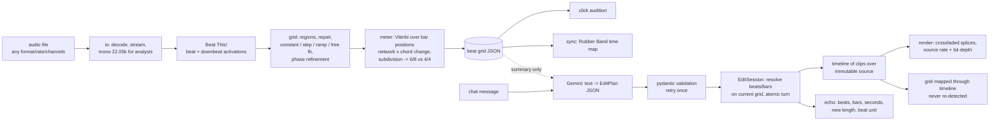

# Beat Agent

One chat-driven agent for audio: (1) a beat grid you can trust and two-track beat-matching, (2) chat
edits addressed in beats and bars, applied without clicks, (3) audio -> playable Web Audio page
*(Part 3 not built yet)*.

**The LLM interprets; code measures and executes.** Tempo, beats, downbeats, meter and tempo changes come
from Beat This! plus our own signal processing. The LLM (Gemini) only turns a chat message into typed edit
operations addressed in beats/bars; code resolves them to samples on the current grid, applies them, and
echoes exactly what it did.

> **Status, honestly:** the official test pack was **not available** while this was built. Results below come
> from (a) **SUBSTITUTE** real-music clips (5 GTZAN excerpts with public human beat annotations, labelled as
> such everywhere) and (b) **generated** audio with exact ground truth. Neither is the test pack. When the test
> pack is dropped into `testpack/`, `make eval` measures it (file-name patterns in `evals/manifest.yaml`).

## Quick start

```bash
cp .env.example .env            # add GEMINI_API_KEY (GEMINI_MODEL defaults to gemini-3.5-flash)
docker compose up               # app on http://localhost:8000
docker compose run --rm app make eval   # every eval, regenerated from scratch
```

Without Docker (Python 3.11, [uv](https://docs.astral.sh/uv/), plus `ffmpeg` and `rubberband-cli` on PATH):

```bash
uv sync --extra dev
uv run python -m evals.substitutes.fetch     # optional: substitute GTZAN clips (not committed)
uv run beat-agent analyze song.mp3           # grid JSON + click audition
uv run beat-agent sync a.wav b.wav --at-bar 33
uv run beat-agent chat song.wav              # interactive chat editing
uv run uvicorn beat_agent.app.server:app     # preview app
uv run python -m pytest -m "not slow and not llm"
```

## Status

<!-- STATUS:BEGIN (generated by python -m evals.status; do not edit by hand) -->
### Part 1 -- beat grid and sync ([evals/results/part1.md](evals/results/part1.md))

- **Test pack:** not present at eval time (A1, A2, A3, A4, A5, A6, A7 missing) -- nothing measured on it.

| clip | kind | beat F | downbeat F | max drift ms | mean signed ms | BPM | type | meter |
|---|---|---|---|---|---|---|---|---|
| sub-disco | SUBSTITUTE (GTZAN) | 1.0 | 1.0 | 34.19 | -11.64 | 114.904 | variable | 4/4 |
| sub-hiphop | SUBSTITUTE (GTZAN) | 1.0 | 1.0 | 36.42 | -25.29 | 119.197 | constant | 4/4 |
| sub-rock | SUBSTITUTE (GTZAN) | 0.8039 | 0.7692 | 50.73 | 4.58 | 121.567 | constant | 4/4 |
| sub-jazz | SUBSTITUTE (GTZAN) | 0.5359 | 0.0 | 69.86 | -18.48 | 241.212 | variable | 6/8 |
| sub-country | SUBSTITUTE (GTZAN) | 0.9577 | 1.0 | 64.62 | 5.46 | 84.466 | constant | 4/4 |
| G-house-6min | generated | 1.0 | 1.0 | 1.14 | -1.03 | 124.0 | constant | 4/4 |
| G-house-partner | generated | 1.0 | 1.0 | 1.53 | -1.15 | 118.499 | constant | 4/4 |
| G-step | generated | 1.0 | 1.0 | 2.62 | -1.19 | 126.612 | variable | 4/4 |
| G-waltz | generated | 1.0 | 1.0 | 1.61 | -0.18 | 99.998 | constant | 3/4 |
- Sync A7 -> A1 at A1 bar 33: **missing**.
- Sync G-house-partner -> G-house-6min at G-house-6min bar 33 (generated): kick offsets median 0.339 ms, max 2.083 ms over 121 pairs.
- Speed: 362.3 s generated track analysed in 12.17 s on this laptop CPU.

### Generalisation / robustness on generated audio ([evals/results/robustness.md](evals/results/robustness.md))

- 27 pass, 7 partial, 2 fail of 36 cases.
  - partial: `random_02_6-8_108.7bpm` -- hypermeter: 12/8 for 6/8
  - partial: `random_03_6-8_102.8bpm` -- hypermeter: 12/8 for 6/8
  - fail: `random_05_3-4_138.8bpm` -- meter 4/4, expected 3/4
  - partial: `random_07_6-8_71.8bpm` -- eighth-note level (compound meter); constant grid off by up to 15.13 ms (> 10.0 ms)
  - fail: `random_08_3-4_149.8bpm` -- meter 6/8, expected 3/4
  - partial: `random_11_6-8_88.1bpm` -- hypermeter: 12/8 for 6/8
  - partial: `tempo_60` -- tempo octave error: tracked 119.991 BPM vs 60.0; x1 alternative exposed; F at the tracked level 1.000
  - partial: `tempo_200` -- tempo octave error: tracked 99.99 BPM vs 200.0; x2 alternative exposed; F at the tracked level 1.000
  - partial: `meter_6-8_84` -- hypermeter: 12/8 for 6/8

### Part 2 -- chat editing ([evals/results/part2.md](evals/results/part2.md))

- Model `gemini-3.5-flash`, real API (cached for re-runs). Cumulative LLM spend so far: 18 calls, est. $0.0479 (upper-bound pricing).

| session | ran on | statuses | clicks at splices | hard-cut control flagged | grid vs re-tracked (beat F) |
|---|---|---|---|---|---|
| S1 | sub-disco (SUBSTITUTE) | applied, applied, undo, applied | 0 / 5 | 5 / 5 | 1.0, 0.9932, 1.0, 1.0 |
| S2 | sub-hiphop (SUBSTITUTE) | applied | 0 / 3 | 0 / 3 | 1.0 |
| S3 | G-step (generated) | applied | 0 / 1 | 0 / 1 | 1.0 |
| S3b | sub-disco (SUBSTITUTE) | error | 0 / 0 | 0 / 0 | - |
| S4 | sub-disco (SUBSTITUTE) | proposal | 0 / 0 | 0 / 0 | - |
| S5 | sub-rock (SUBSTITUTE) | applied, error | 0 / 1 | 0 / 1 | 0.9245 |
| S4b | sub-country (SUBSTITUTE) | proposal, applied | 0 / 1 | 0 / 1 | 1.0 |
| S6 | sub-jazz (SUBSTITUTE) | applied, applied | 0 / 1 | 0 / 1 | 1.0, 0.931 |
| S7 | sub-hiphop (SUBSTITUTE) | clarify | 0 / 0 | 0 / 0 | - |
| S8 | sub-rock (SUBSTITUTE) | applied, applied | 0 / 1 | 0 / 1 | 1.0, 0.9828 |

### Part 3 -- audio to Web Audio

- not built yet (Phase 3).
<!-- STATUS:END -->

## How it works



- **Conventions** (stated in every grid JSON and every echo): beats 0-based (beat 0 = first downbeat,
  pickup beats negative), bars 1-based; beat ranges half-open (`beat 16-32` = 16 beats), bar ranges inclusive.
- **LLM/code boundary:** the model sees a grid *summary* (counts, meter, tempo segments; no beat times) and
  returns only typed ops (`remove`, `keep_only`, `repeat{times_total}`, `move`, `insert_copy`, `fade`, `gain`,
  grid corrections, `propose_cut`, `confirm_proposal`, `undo`, `redo`, `clarify`, `reject`). It cannot express
  seconds. Out-of-range requests are passed through and rejected by code with the real limits.
- **Edits** live on a virtual timeline over the untouched source: untouched samples are bit-identical,
  undo is a snapshot, the edited grid is the source grid moved by the same clip offsets.
- Key decisions and every ambiguity reading: [DECISIONS.md](DECISIONS.md). Known mistakes made while
  building (raw material for AI_USAGE.md): [notes/ai_mistakes_log.md](notes/ai_mistakes_log.md).

## Layout

`beat_agent/analysis` grid, tempo, meter · `beat_agent/edit` EDL, timeline, grid mapping, session ·
`beat_agent/agent` LLM provider + prompt + validation · `beat_agent/sync` · `beat_agent/app` preview UI ·
`evals/` harness, manifest, generated audio, substitutes, results · `tests/` (incl. `test_no_hardcoding.py`).
All thresholds with their justification: `beat_agent/config.py`.
